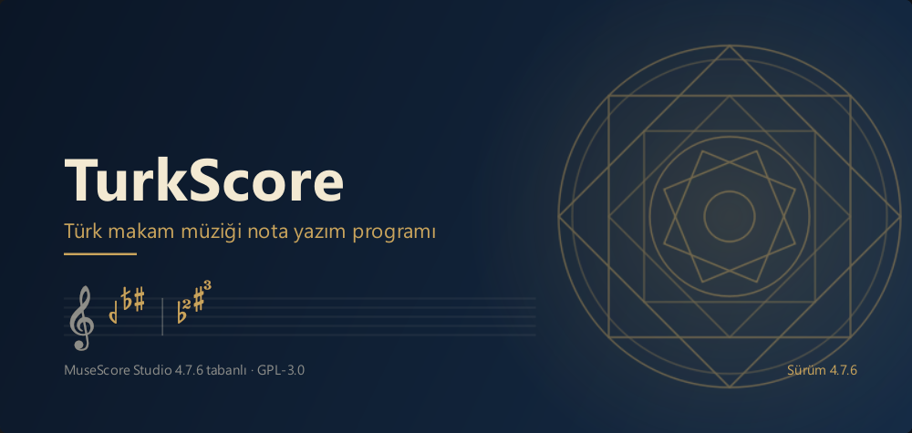
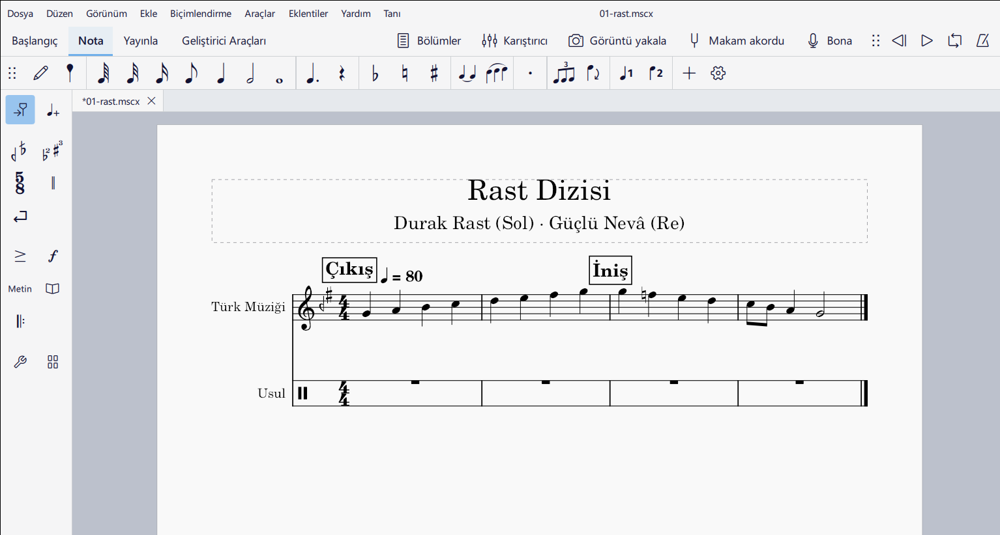

# TurkScore

**Türk makam müziği nota yazım programı.** Açık kaynaklı [MuseScore Studio](https://musescore.org) 4.7 üzerine kurulmuştur; makam, usul ve koma arızalarını eklentisiz, yerleşik olarak yazar ve çalar.

## İndir

| | |
|---|---|
| **Windows** (taşınabilir, kurulum gerekmez) | [TurkScore-0.2-Windows.zip](https://github.com/bariskaraelma/TurkScore/releases/download/turkscore-0.2/TurkScore-0.2-Windows.zip) |
| **Mac** (Apple Silicon ve Intel) | [TurkScore-0.2-Mac.dmg](https://github.com/bariskaraelma/TurkScore/releases/download/turkscore-0.2/TurkScore-0.2-Mac.dmg) |

Bütün sürümler ve kurulum adımları: **[Sürümler (Releases)](https://github.com/bariskaraelma/TurkScore/releases/latest)**. İndirmek için GitHub hesabı gerekmez.

## Neler var

- **Finale benzeri araç çubuğu:** notanın solunda Seçim, Nota girişi, Makam, THM, Usul, Artikülasyon, Nüans, Metin… (istenirse MuseScore'un palet paneli)
- **AEU donanımları ve arızaları:** 17 makam donanımı; koma, bakiye, küçük ve büyük mücennep diyez/bemoller; kendi donanımınızı oluşturma
- **THM (TRT Türk halk müziği) donanımları** ve 1–5 komalık diyez/bemoller
- **Makama göre perde ayarı:** notalar yazıldığı makamın perdeleriyle çalınır; Makam akordu penceresi, "Diziyi dinle"
- **Ahenk:** Bolâhenk'ten Dâvut Mâbeyni'ne ney ahenkleri
- **Türk arıza ↑/↓ adımları:** ↑/↓ tuşları notayı Türk arızalarının basamaklarıyla yükseltir, alçaltır
- **Usuller:** 17 usul, kendi usulünüzü oluşturma, düm/tek çalan usullü metronom
- **Türk müziği çalgıları**
- **Makam Eğitimi:** makam dizileri, usuller ve örnek eserlerle hazır dersler
- **Bona (deneysel):** mikrofona söyleyerek ritim girişi
- **Görüntü yakalama:** notanın bir bölümünü resim olarak kopyalama

## Kaynaktan derleme

Windows'ta derleme adımları: [makam/KURULUM.md](makam/KURULUM.md). Geliştirme dalı: `makam-4.7.6`.

## Lisans ve teşekkür

TurkScore, [MuseScore Studio](https://github.com/musescore/MuseScore)'nun bir çatalıdır ve aynı lisansla, [GNU GPL v3](LICENSE.txt) ile dağıtılır. MuseScore'u yapan bütün katkıcılara teşekkürler.

"MuseScore" Muse Group'un markasıdır. TurkScore, Muse Group ya da MuseScore projesiyle bağlantılı değildir ve onlar tarafından desteklenmez.
